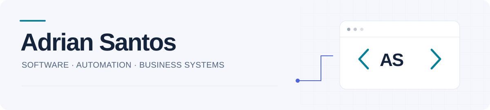

<picture>
  <source media="(prefers-color-scheme: dark)" srcset="assets/header-dark.svg">
  
</picture>

### Desenvolvimento de software e automação de processos

**Backend · Aplicações desktop e web · Dados fiscais e documentais**

[Sobre](#sobre) · [Projetos](#projetos) · [Tecnologias](#tecnologias) · [English](#english)

## Sobre

Sou **Adrian Santos**, desenvolvedor no Brasil. Construo ferramentas para organizar informações, reduzir tarefas repetitivas e tornar rotinas de negócio mais fáceis de executar e acompanhar.

Meu trabalho conecta desenvolvimento de software a problemas concretos: consultar dados fiscais, organizar documentos, acompanhar oportunidades comerciais e estruturar a execução de projetos. Uso **Java, Python e JavaScript**, com aplicações que vão de APIs a interfaces desktop e web.

## Projetos

### Automação e dados fiscais

| Projeto | Problema que resolve | Tecnologias |
| --- | --- | --- |
| [**Extrator SPED**](https://github.com/AdrianSantosBFX/extrator-sped) | Facilita a exploração de arquivos EFD ICMS/IPI, com consultas de documentos, produtos e itens, filtros e exportações CSV, XLSX e PDF. | Java · Swing |
| [**Facilita.sig**](https://github.com/AdrianSantosBFX/facilita-sig) | Organiza cadastros de empresas e a revisão de documentos fiscais, com importação de XML de NF-e/NFS-e e persistência local. | Java · Swing · SQLite · Maven |
| [**GED Documental**](https://github.com/AdrianSantosBFX/ged-documental) | Reconhece relatórios PDF e organiza documentos por empresa e competência, com cadastro por Cartão CNPJ e encaminhamento para revisão. | Java · PDFBox · JavaScript |

### Sistemas para a operação de negócios

| Projeto | Problema que resolve | Tecnologias |
| --- | --- | --- |
| [**ELEVAR.CRM**](https://github.com/AdrianSantosBFX/elevar-crm) | Reúne relacionamento comercial, diagnóstico, propostas, contratos e acompanhamento de projetos em um protótipo local. | HTML · CSS · JavaScript |
| [**ELEVAR.FLOW**](https://github.com/AdrianSantosBFX/elevar-flow) | Estrutura a execução de projetos com Kanban, tarefas, prazos, marcos de entrega, riscos e templates. | HTML · CSS · JavaScript |

Cada repositório inclui o código e as instruções de execução. Os projetos estão em evolução; o escopo e as limitações de cada versão estão documentados nos respectivos READMEs. As ferramentas fiscais apoiam a consulta e a revisão de dados e não substituem validações oficiais.

## Tecnologias

| Área | Ferramentas |
| --- | --- |
| Backend e APIs | Python · FastAPI · APIs HTTP |
| Aplicações desktop | Java · Swing |
| Interfaces web | JavaScript · HTML · CSS |
| Dados e documentos | SQL · SQLite · XML · PDF · CSV · XLSX |
| Desenvolvimento | Git · GitHub · Maven |

## Como desenvolvo

- **Fluxos claros:** separar etapas, responsabilidades e estados para facilitar o uso e a manutenção.
- **Dados com contexto:** distinguir valores declarados, estimativas e informações ainda não preenchidas.
- **Processamento local quando faz sentido:** manter arquivos e persistência próximos de quem utiliza a ferramenta.
- **Evolução verificável:** usar exemplos fictícios, testes e instruções de execução para apoiar as próximas mudanças.

---

<strong>English — About me and selected work</strong>

### Software development and business automation

I'm **Adrian Santos**, a developer based in Brazil. I build tools that organize information, reduce repetitive work and make business workflows easier to run and review.

My work connects software development with fiscal data, document management, sales operations and project delivery. I use **Java, Python and JavaScript** across backend APIs, desktop applications and web interfaces.

### Public projects

| Project | Focus |
| --- | --- |
| [**Extrator SPED**](https://github.com/AdrianSantosBFX/extrator-sped) | Explore Brazilian EFD ICMS/IPI files, filter documents and items, and export CSV, Excel and PDF results. |
| [**Facilita.sig**](https://github.com/AdrianSantosBFX/facilita-sig) | Manage company records and review fiscal documents with NF-e/NFS-e XML imports and local SQLite storage. |
| [**GED Documental**](https://github.com/AdrianSantosBFX/ged-documental) | Recognize PDF reports and organize documents by registered company and reporting period. |
| [**ELEVAR.CRM**](https://github.com/AdrianSantosBFX/elevar-crm) | A local CRM prototype for sales, discovery, proposals, contracts and project follow-up. |
| [**ELEVAR.FLOW**](https://github.com/AdrianSantosBFX/elevar-flow) | Project execution with Kanban boards, tasks, deadlines, milestones, risks and reusable templates. |

**Toolbox:** Java, Swing, Python, FastAPI, JavaScript, HTML, CSS, SQL, SQLite, Git and Maven.

I focus on clear workflows, data with context, local processing where appropriate, and changes supported by examples, tests and documentation.

These projects are evolving. Their READMEs describe setup, scope and limitations. Fiscal tools support data exploration and review; they do not replace official validation.

[Explorar todos os repositórios públicos →](https://github.com/AdrianSantosBFX?tab=repositories)

